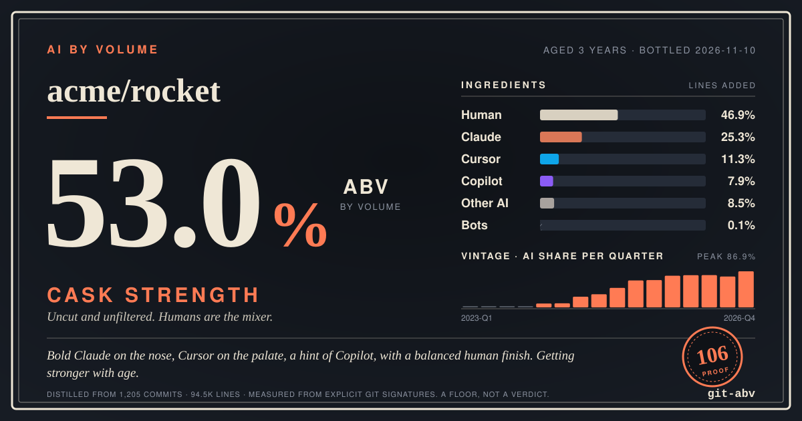
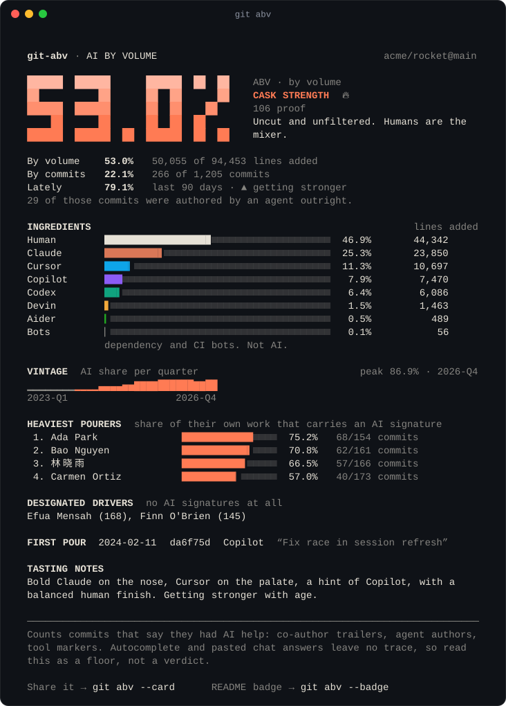
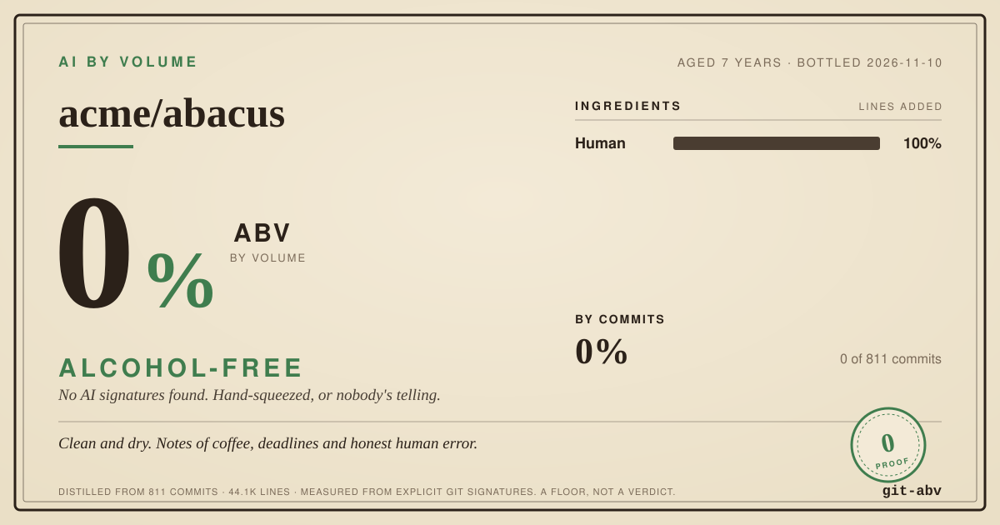
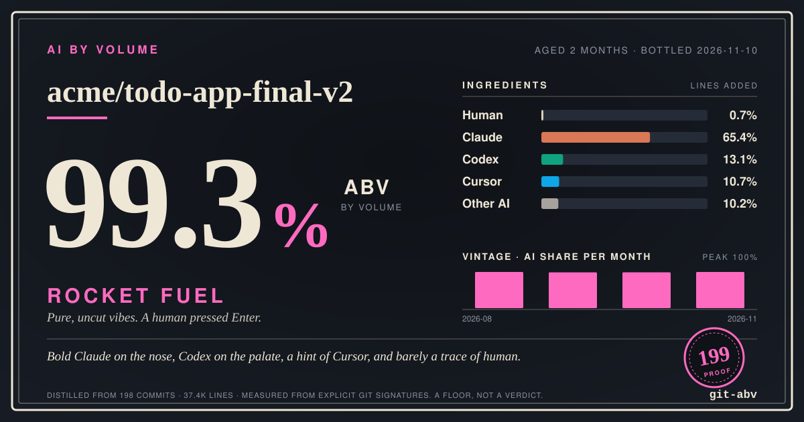
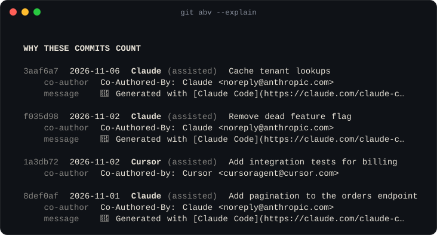

<p align="center">
  
</p>

<h1 align="center">git-abv</h1>

<p align="center">
  <b>AI By Volume.</b> One command tells you how much of a repo was written with AI.<br>
  Like the number on a bottle, but for your git history.
</p>

<p align="center">
  <a href="https://github.com/cszass/git-abv/actions/workflows/ci.yml"></a>
  
  
  
</p>

<p align="center">
  <a href="https://cszass.github.io/git-abv/"><b>Try it in your browser</b></a> ·
  <a href="#the-top-shelf">The top shelf</a> ·
  <a href="SIGNATURES.md">What counts</a> ·
  <a href="README.zh-CN.md">简体中文</a>
</p>

```bash
npx git-abv
```

No install, no account, no token, no upload. It reads your local git history and nothing else.

<p align="center">
  
</p>

## What it does

AI coding tools sign their work. Claude Code adds a `Co-Authored-By` trailer. Copilot's agent commits under its own name. The Linux kernel asks contributors for `Assisted-by:`. **git-abv knows how more than 40 tools sign**, walks your history once, and adds it up:

- **ABV, by volume.** The share of added lines that arrived in commits carrying an AI signature. Lockfiles, vendored code and generated files are left out, so one `package-lock.json` cannot drown a month of work.
- **By commits, by tool, by month, by author**, plus the date of the first pour.
- **A label** to share, **a badge** for your README, **JSON** for everything else, and **a CI gate** if your project has a policy.

It counts what commits *say about themselves*. Autocomplete and pasted chat answers leave no trace, and signatures can be switched off. So the result is **a floor, not a verdict**. It is not a quality score either: a high number is not an insult, and a low one is not a medal.

## The label

```bash
git abv --card                          # writes abv-label.svg
git abv --card --theme night --lang zh  # dark, in Chinese
```

A 1200×630 SVG, sized for social cards and slides. No fonts embedded, no scripts, no external requests, so it renders anywhere, GitHub included.

<table>
  <tr>
    <td></td>
    <td></td>
  </tr>
</table>

<sub>The three repos pictured here are fictional and generated by <code>npm run demo</code>. Real ones are below.</sub>

Every ABV has a style:

| ABV | Style | What the label says |
| ---: | --- | --- |
| 0% | **Alcohol-Free** | No AI signatures found. Hand-squeezed, or nobody's telling. |
| under 0.5% | **Kombucha** | May contain traces of AI. |
| 0.5 – 3% | **Shandy** | Mostly lemonade, with a splash of AI. |
| 3 – 8% | **Lager** | Light and sessionable. Humans still do the heavy lifting. |
| 8 – 16% | **Wine** | A glass with dinner. AI is a regular at the table. |
| 16 – 25% | **Port** | Fortified. The AI is doing real work now. |
| 25 – 45% | **Whisky** | Proper spirit. Sip, don't chug. |
| 45 – 60% | **Cask Strength** | Uncut and unfiltered. Humans are the mixer. |
| 60 – 80% | **Absinthe** | The green fairy writes most of the code. |
| 80 – 95% | **Rectified Spirit** | Nearly pure. Keep away from open flames and unreviewed PRs. |
| 95% and up | **Rocket Fuel** | Pure, uncut vibes. A human pressed Enter. |

## The top shelf

How strong are the projects you use every day?

<!-- shelf:start -->
Measured on **2026-11-10**: the share of commits since 2025-11-10 that carry an AI signature (non-merge commits on the default branch).
Across these 48 projects, **40,346 of 359,305 commits (11.2%)** say they had AI help, and 45 of the 48 have at least one.

| Repository | ABV | Style | AI-signed commits | On the nose |
| --- | ---: | --- | ---: | --- |
| [Aider-AI/aider](https://github.com/Aider-AI/aider) | **85.2%** | Rectified Spirit | 75 / 88 | Aider |
| [dotnet/runtime](https://github.com/dotnet/runtime) | **51.8%** | Cask Strength | 3,480 / 6,713 | Copilot |
| [OpenHands/OpenHands](https://github.com/OpenHands/OpenHands) | **50.1%** | Cask Strength | 1,756 / 3,508 | OpenHands |
| [microsoft/vscode](https://github.com/microsoft/vscode) | **39.2%** | Whisky | 9,799 / 24,995 | Copilot |
| [n8n-io/n8n](https://github.com/n8n-io/n8n) | **36.4%** | Whisky | 3,887 / 10,680 | Claude |
| [continuedev/continue](https://github.com/continuedev/continue) | **25.9%** | Whisky | 290 / 1,120 | Claude |
| [microsoft/TypeScript](https://github.com/microsoft/TypeScript) | **21.6%** | Port | 406 / 1,875 | Copilot |
| [home-assistant/core](https://github.com/home-assistant/core) | **19.3%** | Port | 4,365 / 22,599 | Claude |
| [anomalyco/opencode](https://github.com/anomalyco/opencode) | **17.6%** | Port | 3,253 / 18,427 | opencode |
| [nodejs/node](https://github.com/nodejs/node) | **16.5%** | Port | 659 / 3,993 | Codex |
| [denoland/deno](https://github.com/denoland/deno) | **14.8%** | Wine | 430 / 2,905 | Claude |
| [tldraw/tldraw](https://github.com/tldraw/tldraw) | **12.6%** | Wine | 250 / 1,981 | Claude |
| [supabase/supabase](https://github.com/supabase/supabase) | **10.8%** | Wine | 694 / 6,445 | Claude |
| [oven-sh/bun](https://github.com/oven-sh/bun) | **9.9%** | Wine | 456 / 4,615 | Claude |
| [aaif-goose/goose](https://github.com/aaif-goose/goose) | **9.0%** | Wine | 286 / 3,180 | Claude |
| [huggingface/transformers](https://github.com/huggingface/transformers) | **8.9%** | Wine | 323 / 3,641 | Claude |

<details>
<summary>The rest of the shelf (32 more)</summary>

| Repository | ABV | Style | AI-signed commits | On the nose |
| --- | ---: | --- | ---: | --- |
| [rails/rails](https://github.com/rails/rails) | **8.3%** | Wine | 219 / 2,625 | Claude |
| [python/cpython](https://github.com/python/cpython) | **8.0%** | Wine | 416 / 5,198 | Claude |
| [cloudflare/workers-sdk](https://github.com/cloudflare/workers-sdk) | **7.0%** | Lager | 193 / 2,760 | Devin |
| [torvalds/linux](https://github.com/torvalds/linux) | **6.7%** | Lager | 6,157 / 91,739 | Claude |
| [react/react](https://github.com/react/react) | **6.6%** | Lager | 40 / 610 | Claude |
| [cline/cline](https://github.com/cline/cline) | **6.2%** | Lager | 230 / 3,735 | Claude |
| [vercel/next.js](https://github.com/vercel/next.js) | **5.7%** | Lager | 290 / 5,060 | Claude |
| [langchain-ai/langchain](https://github.com/langchain-ai/langchain) | **5.4%** | Lager | 130 / 2,416 | Open SWE |
| [tailwindlabs/tailwindcss](https://github.com/tailwindlabs/tailwindcss) | **5.2%** | Lager | 21 / 402 | Claude |
| [pytorch/pytorch](https://github.com/pytorch/pytorch) | **5.2%** | Lager | 943 / 18,182 | Claude |
| [anthropics/claude-code](https://github.com/anthropics/claude-code) | **5.0%** | Lager | 29 / 579 | Claude |
| [excalidraw/excalidraw](https://github.com/excalidraw/excalidraw) | **4.9%** | Lager | 14 / 287 | Claude |
| [google-gemini/gemini-cli](https://github.com/google-gemini/gemini-cli) | **4.7%** | Lager | 156 / 3,357 | Gemini |
| [astral-sh/uv](https://github.com/astral-sh/uv) | **4.4%** | Lager | 158 / 3,568 | Claude |
| [vitejs/vite](https://github.com/vitejs/vite) | **3.4%** | Lager | 41 / 1,213 | Copilot |
| [openai/codex](https://github.com/openai/codex) | **3.1%** | Lager | 358 / 11,466 | Codex |
| [sveltejs/svelte](https://github.com/sveltejs/svelte) | **3.0%** | Shandy | 23 / 767 | Claude |
| [ghostty-org/ghostty](https://github.com/ghostty-org/ghostty) | **2.7%** | Shandy | 113 / 4,126 | Claude |
| [zed-industries/zed](https://github.com/zed-industries/zed) | **2.2%** | Shandy | 178 / 8,152 | Claude |
| [neovim/neovim](https://github.com/neovim/neovim) | **1.5%** | Shandy | 60 / 3,906 | Claude |
| [astral-sh/ruff](https://github.com/astral-sh/ruff) | **1.5%** | Shandy | 79 / 5,317 | Claude |
| [withastro/astro](https://github.com/withastro/astro) | **1.3%** | Shandy | 30 / 2,334 | Claude |
| [golang/go](https://github.com/golang/go) | **0.5%** | Shandy | 21 / 3,873 | Claude |
| [ollama/ollama](https://github.com/ollama/ollama) | **0.3%** | Kombucha | 4 / 1,195 | Claude |
| [kubernetes/kubernetes](https://github.com/kubernetes/kubernetes) | **0.2%** | Kombucha | 10 / 5,819 | Claude |
| [fastapi/fastapi](https://github.com/fastapi/fastapi) | **0.2%** | Kombucha | 3 / 1,832 | Claude |
| [rust-lang/rust](https://github.com/rust-lang/rust) | **0.1%** | Kombucha | 14 / 22,181 | Claude |
| [curl/curl](https://github.com/curl/curl) | **0.1%** | Kombucha | 2 / 3,602 | Claude |
| [ladybirdbrowser/ladybird](https://github.com/ladybirdbrowser/ladybird) | **<0.1%** | Kombucha | 5 / 20,620 | Claude |
| [django/django](https://github.com/django/django) | **0%** | Alcohol-Free | 0 / 1,086 | - |
| [godotengine/godot](https://github.com/godotengine/godot) | **0%** | Alcohol-Free | 0 / 4,088 | - |
| [vuejs/core](https://github.com/vuejs/core) | **0%** | Alcohol-Free | 0 / 445 | - |

</details>
<!-- shelf:end -->

**How to read this**

- **It rewards honesty.** A high number mostly means a project is open about how it is built. A low number means either little AI, or little disclosure. The table cannot tell which, and neither can anyone else.
- **It is a floor.** Take [oven-sh/bun](https://github.com/oven-sh/bun), at 9.9%. One account, `robobun`, authored 62% of the commits in that window (2,860 of 4,615). From November to February, about nine in ten of its commits carried a Claude co-author trailer. From April to September, 0 of 2,453 did. Count that account as an agent (`--ai-identity '^robobun\b'`) and the same history reads **68.6%**.
- **It is by commits.** Line counts need full clones, and the shelf is measured from commit metadata alone. Run `npx git-abv` in a real clone for the number by volume.
- **Check our work.** `node scripts/top-shelf.mjs` reproduces the table. `git abv --explain` shows every signature that matched. The [web version](https://cszass.github.io/git-abv/) pours any public repo live and links each commit that counted.

Want a repository on the shelf? Add it to [`scripts/top-shelf-repos.txt`](scripts/top-shelf-repos.txt) and open a PR.

## Install

```bash
npx git-abv              # run it once, install nothing
```

```bash
npm install -g git-abv   # then it is a git subcommand: `git abv`
```

Needs Node.js 18+ and git. Zero dependencies. Works on macOS, Linux and Windows, on GitHub, GitLab, Bitbucket and bare repositories.

## Usage

```bash
git abv                         # this repo, whole history
git abv ~/code/some-repo        # another repo
git abv --year 2026             # a single vintage
git abv --since "6 months ago"  # anything `git log --since` understands
git abv --only packages/api     # one corner of a monorepo
git abv --author alice          # one person's commits (be kind)
git abv --fast                  # skip line counts, measure by commits (for huge repos)
```

See why a number is what it is:

```bash
git abv --explain               # which signatures matched, how often, with sample commits
git abv --suspects              # bot-looking accounts the database does not recognise
git abv --signatures            # everything git-abv knows how to spot
```

<p align="center">
  
</p>

Teach it about your own agents and your own noise:

```bash
git abv --ai-identity '^acme-agent\b'   # count a custom bot account as AI
git abv --exclude 'fixtures/' --exclude '*.snap'
git abv --no-default-excludes           # count lockfiles and vendored code too
```

Get the data out:

```bash
git abv --json | jq .abv
git abv --card --badge --quiet          # just write the files
git abv --lang zh                       # 中文输出
```

<details>
<summary>All options</summary>

```
Measure
  --since <date>          only commits after <date>  (anything `git log` understands)
  --until <date>          only commits before <date>
  --year <yyyy>           a single vintage, e.g. --year 2026
  --rev <range>           revision or range to scan  (default: HEAD)
  --all                   scan every branch and tag
  --author <pattern>      only commits by matching authors (repeatable)
  --only <pathspec>       only count changes under a path (repeatable)
  --exclude <glob>        leave matching files out of line counts (repeatable)
  --no-default-excludes   count lockfiles, vendored and generated files too
  --fast                  skip line counting and measure by commits (much quicker on huge repos)
  --ai-identity <regex>   also count a matching "Name <email>" as AI (repeatable)

Output
  --card[=file.svg]       write a shareable label    (default: abv-label.svg)
  --badge[=file.svg]      write a README badge       (default: abv-badge.svg)
  --theme <paper|night>   label theme                (default: paper)
  --name <text>           name to print on the label
  --json                  print the full report as JSON
  --lang <en|zh>          output language            (default: from your locale)
  --top <n>               how many authors to list   (default: 5)
  --no-authors            hide the per-author sections
  --explain[=n]           show n matched commits and what gave them away (default: 10)
  --suspects              list bot-looking identities missing from the signature database
  --signatures            list every signature git-abv knows
  -q, --quiet             print nothing but errors (handy with --card, --badge, --max)
  --ascii, --no-color     plain output

CI
  --max <pct>             exit 1 if ABV is above <pct>
  --min <pct>             exit 1 if ABV is below <pct>

  -h, --help              -v, --version
```

Exit codes: `0` fine, `1` a `--max` or `--min` gate failed, `2` something went wrong.

</details>

## A badge for your README

```bash
git abv --badge     # writes abv-badge.svg
```

```markdown

```

  

The badge is a file in your repo, in the colour of its style. No badge service, no tracking pixel.

### Keep it fresh with GitHub Actions

```yaml
# .github/workflows/abv.yml
name: ABV
on:
  push:
    branches: [main]
permissions:
  contents: write
jobs:
  abv:
    runs-on: ubuntu-latest
    steps:
      - uses: actions/checkout@v5
        with:
          fetch-depth: 0          # the whole history, or the number is meaningless
      - uses: cszass/git-abv@main
        with:
          badge: abv-badge.svg
          card: abv-label.svg     # optional
          commit: true            # push the refreshed files back
```

The action also writes a job summary, exposes `abv` and `style` as outputs, and can enforce a policy:

```yaml
      - uses: cszass/git-abv@main
        with:
          max: 20                 # fail the job above 20% ABV. Or `min:`, if that is your kind of shop.
```

## How it decides

A commit counts when it carries an explicit signature:

| Signal | Example |
| --- | --- |
| The author is an agent | `devin-ai-integration[bot]`, `copilot-swe-agent[bot]`, `Cursor Agent <cursoragent@cursor.com>` |
| An agent is a co-author | `Co-Authored-By: Claude <noreply@anthropic.com>` |
| A trailer says so | `Assisted-by: Claude:claude-sonnet-4-6`, `Amp-Thread-ID: …`, `Replit-Commit-Author: Agent` |
| The message carries a tool's marker | `🤖 Generated with [Claude Code](…)`, `aider: …` |

And just as important, what does **not** count:

- **People.** `Claude Dupont <claude@example.com>` is a colleague, not a model. Rules match mailboxes and bot logins, never a human-sounding name on its own.
- **Mentions.** "Copilot suggested this" in a commit body is prose.
- **Plain automation.** Dependabot, Renovate and friends land in a separate *Bots* bucket, so a wall of version bumps never inflates the number.
- **Merge commits**, which would count the same work twice.

The full list, tool by tool, is in [SIGNATURES.md](SIGNATURES.md). The rules live in one plain data file, [`src/core/signatures.js`](src/core/signatures.js), and every rule has tests on both sides: what must match, and who must not.

## FAQ

**Is this accurate?**
It is exact about what it measures: commits that declare AI involvement. As an estimate of "how much code did AI really write" it is a lower bound, sometimes a very low one. Treat it like a nutrition label: useful, honest about what is listed, silent about what is not.

**Does anything leave my machine?**
No. The CLI runs one `git log` and makes no network requests. The web version talks to the public GitHub API from your browser and to nothing else.

**Why lines added, and not commits?**
Because "by volume" should mean volume. An agent's commit is often ten times the size of a human's, and the two numbers can differ a lot. You get both; pick the one that answers your question.

**Should I use this to rank my team?**
Please don't. It measures who lets their tools sign commits, which is mostly a settings toggle. Use `--no-authors` if the per-person section makes anyone nervous.

**My repo says 0% but I use AI all day.**
Then your tools are not signing. That is the point of the floor. Most agents add a trailer by default; some editors and most autocomplete never do.

**A tool is missing, or something is miscounted.**
Run `git abv --suspects`, then [open an issue](https://github.com/cszass/git-abv/issues/new/choose) or send a PR. Adding a signature is usually one line plus a test.

**Why "ABV"?**
Because "percentage of added lines attributable to commits bearing an explicit AI authorship signature" does not fit on a badge.

## Contributing

The signature database only stays current if people who use these tools keep it honest. See [CONTRIBUTING.md](CONTRIBUTING.md). The one rule above all: **never match a human.**

## Colophon

git-abv's own label reads **100% ABV: Rocket Fuel**. It was written by Claude, Anthropic's AI, in one overnight session, because a human asked for it and then went to bed. The tool is not shy about that sort of thing, so neither are we.

Not affiliated with any AI vendor, or any distillery. [MIT licensed](LICENSE).
