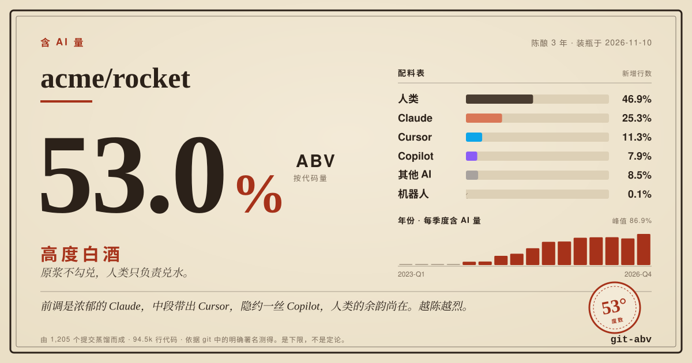
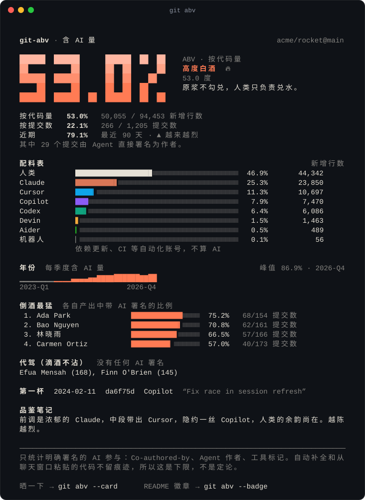
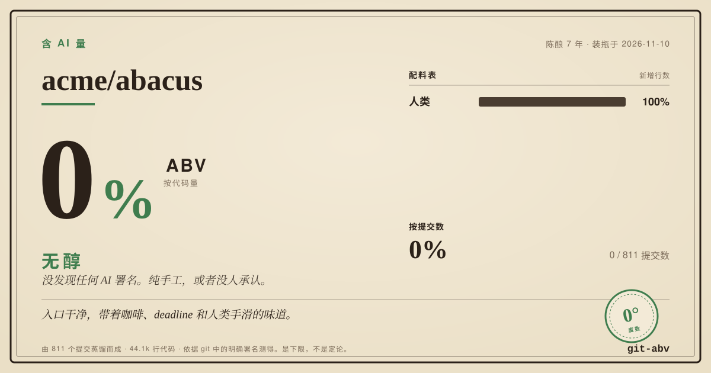
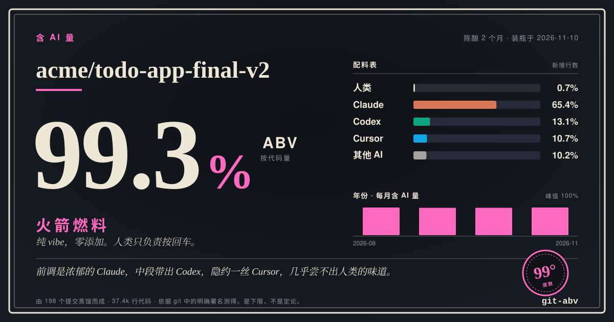
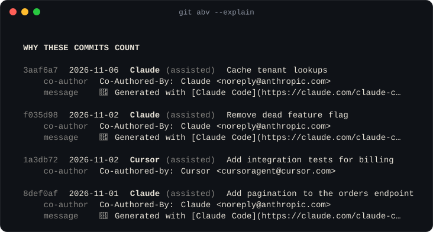

<p align="center">
  
</p>

<h1 align="center">git-abv</h1>

<p align="center">
  <b>含 AI 量（AI By Volume）。</b>一条命令，测出一个仓库里有多少代码是 AI 写的。<br>
  就像酒瓶上的度数，只不过量的是你的 git 历史。
</p>

<p align="center">
  <a href="https://github.com/YOUR_GITHUB_USERNAME/git-abv/actions/workflows/ci.yml"></a>
  
  
  
</p>

<p align="center">
  <a href="https://YOUR_GITHUB_USERNAME.github.io/git-abv/"><b>在浏览器里直接试</b></a> ·
  <a href="#名酒榜">名酒榜</a> ·
  <a href="SIGNATURES.md">哪些算数</a> ·
  <a href="README.md">English</a>
</p>

```bash
npx git-abv
```

不用安装，不用注册，不用 token，不上传任何东西。它只读你本地的 git 历史。

<p align="center">
  
</p>

## 它做什么

AI 编程工具会给自己的产出署名：Claude Code 会加一行 `Co-Authored-By`，Copilot 的 Agent 用自己的账号提交，Linux 内核要求贡献者写 `Assisted-by:`。**git-abv 认识 40 多种工具的署名方式**，把你的历史从头到尾过一遍，然后算账：

- **按代码量算的含 AI 量。** 带 AI 署名的提交所新增的代码行，占全部新增行的比例。lockfile、vendor 目录和生成的文件不计入，免得一个 `package-lock.json` 淹没一个月的工作。
- **按提交数、按工具、按月份、按作者**的拆分，外加"第一杯"的日期。
- **一张酒标**用来晒，**一个徽章**放 README，**JSON** 给程序用，还有 **CI 门禁**，如果你的项目对 AI 有规定的话。

它只统计提交**自己声明**的内容。自动补全、从聊天窗口粘贴的代码不留痕迹，署名也可以关掉。所以结果是**下限，不是定论**。它也不是质量分：度数高不丢人，度数低也不是勋章。

## 酒标

```bash
git abv --card                          # 生成 abv-label.svg
git abv --card --theme night --lang zh  # 暗色、中文
```

1200×630 的 SVG，正好是社交卡片和幻灯片的尺寸。不内嵌字体、没有脚本、不发外部请求，所以在哪儿都能渲染，包括 GitHub。

<table>
  <tr>
    <td></td>
    <td></td>
  </tr>
</table>

<sub>图中三个仓库是虚构的，由 <code>npm run demo</code> 生成。真实仓库的数据见下文。</sub>

每个度数对应一款酒：

| 含 AI 量 | 酒款 | 酒标上写着 |
| ---: | --- | --- |
| 0% | **无醇** | 没发现任何 AI 署名。纯手工，或者没人承认。 |
| 0.5% 以下 | **康普茶** | 可能含有微量 AI。 |
| 0.5 – 3% | **果啤** | 基本是汽水，只兑了一点 AI。 |
| 3 – 8% | **啤酒** | 清爽不上头，活儿主要还是人干的。 |
| 8 – 16% | **葡萄酒** | 佐餐一杯刚刚好，AI 已是桌上常客。 |
| 16 – 25% | **黄酒** | 度数上来了，AI 开始干正事。 |
| 25 – 45% | **威士忌** | 正经烈酒，小口慢品。 |
| 45 – 60% | **高度白酒** | 原浆不勾兑，人类只负责兑水。 |
| 60 – 80% | **烧刀子** | 一口下去，代码大半是 AI 写的。 |
| 80 – 95% | **生命之水** | 接近纯酒精。远离明火，以及没人 review 的 PR。 |
| 95% 以上 | **火箭燃料** | 纯 vibe，零添加。人类只负责按回车。 |

## 名酒榜

你每天在用的那些项目，到底多少度？

<!-- shelf:start -->
实测于 **2026-11-10**：2025-11-10 以来的提交中，带 AI 署名的比例（默认分支上的非合并提交）。
这 48 个项目合计 **359,305 个提交里有 40,346 个（11.2%）**声明了 AI 参与，其中 45 个项目至少有一个这样的提交。

| 仓库 | 含 AI 量 | 酒款 | AI 署名提交 | 主调 |
| --- | ---: | --- | ---: | --- |
| [Aider-AI/aider](https://github.com/Aider-AI/aider) | **85.2%** | 生命之水 | 75 / 88 | Aider |
| [dotnet/runtime](https://github.com/dotnet/runtime) | **51.8%** | 高度白酒 | 3,480 / 6,713 | Copilot |
| [OpenHands/OpenHands](https://github.com/OpenHands/OpenHands) | **50.1%** | 高度白酒 | 1,756 / 3,508 | OpenHands |
| [microsoft/vscode](https://github.com/microsoft/vscode) | **39.2%** | 威士忌 | 9,799 / 24,995 | Copilot |
| [n8n-io/n8n](https://github.com/n8n-io/n8n) | **36.4%** | 威士忌 | 3,887 / 10,680 | Claude |
| [continuedev/continue](https://github.com/continuedev/continue) | **25.9%** | 威士忌 | 290 / 1,120 | Claude |
| [microsoft/TypeScript](https://github.com/microsoft/TypeScript) | **21.6%** | 黄酒 | 406 / 1,875 | Copilot |
| [home-assistant/core](https://github.com/home-assistant/core) | **19.3%** | 黄酒 | 4,365 / 22,599 | Claude |
| [anomalyco/opencode](https://github.com/anomalyco/opencode) | **17.6%** | 黄酒 | 3,253 / 18,427 | opencode |
| [nodejs/node](https://github.com/nodejs/node) | **16.5%** | 黄酒 | 659 / 3,993 | Codex |
| [denoland/deno](https://github.com/denoland/deno) | **14.8%** | 葡萄酒 | 430 / 2,905 | Claude |
| [tldraw/tldraw](https://github.com/tldraw/tldraw) | **12.6%** | 葡萄酒 | 250 / 1,981 | Claude |
| [supabase/supabase](https://github.com/supabase/supabase) | **10.8%** | 葡萄酒 | 694 / 6,445 | Claude |
| [oven-sh/bun](https://github.com/oven-sh/bun) | **9.9%** | 葡萄酒 | 456 / 4,615 | Claude |
| [aaif-goose/goose](https://github.com/aaif-goose/goose) | **9.0%** | 葡萄酒 | 286 / 3,180 | Claude |
| [huggingface/transformers](https://github.com/huggingface/transformers) | **8.9%** | 葡萄酒 | 323 / 3,641 | Claude |

<details>
<summary>榜单的其余部分（还有 32 个）</summary>

| 仓库 | 含 AI 量 | 酒款 | AI 署名提交 | 主调 |
| --- | ---: | --- | ---: | --- |
| [rails/rails](https://github.com/rails/rails) | **8.3%** | 葡萄酒 | 219 / 2,625 | Claude |
| [python/cpython](https://github.com/python/cpython) | **8.0%** | 葡萄酒 | 416 / 5,198 | Claude |
| [cloudflare/workers-sdk](https://github.com/cloudflare/workers-sdk) | **7.0%** | 啤酒 | 193 / 2,760 | Devin |
| [torvalds/linux](https://github.com/torvalds/linux) | **6.7%** | 啤酒 | 6,157 / 91,739 | Claude |
| [react/react](https://github.com/react/react) | **6.6%** | 啤酒 | 40 / 610 | Claude |
| [cline/cline](https://github.com/cline/cline) | **6.2%** | 啤酒 | 230 / 3,735 | Claude |
| [vercel/next.js](https://github.com/vercel/next.js) | **5.7%** | 啤酒 | 290 / 5,060 | Claude |
| [langchain-ai/langchain](https://github.com/langchain-ai/langchain) | **5.4%** | 啤酒 | 130 / 2,416 | Open SWE |
| [tailwindlabs/tailwindcss](https://github.com/tailwindlabs/tailwindcss) | **5.2%** | 啤酒 | 21 / 402 | Claude |
| [pytorch/pytorch](https://github.com/pytorch/pytorch) | **5.2%** | 啤酒 | 943 / 18,182 | Claude |
| [anthropics/claude-code](https://github.com/anthropics/claude-code) | **5.0%** | 啤酒 | 29 / 579 | Claude |
| [excalidraw/excalidraw](https://github.com/excalidraw/excalidraw) | **4.9%** | 啤酒 | 14 / 287 | Claude |
| [google-gemini/gemini-cli](https://github.com/google-gemini/gemini-cli) | **4.7%** | 啤酒 | 156 / 3,357 | Gemini |
| [astral-sh/uv](https://github.com/astral-sh/uv) | **4.4%** | 啤酒 | 158 / 3,568 | Claude |
| [vitejs/vite](https://github.com/vitejs/vite) | **3.4%** | 啤酒 | 41 / 1,213 | Copilot |
| [openai/codex](https://github.com/openai/codex) | **3.1%** | 啤酒 | 358 / 11,466 | Codex |
| [sveltejs/svelte](https://github.com/sveltejs/svelte) | **3.0%** | 果啤 | 23 / 767 | Claude |
| [ghostty-org/ghostty](https://github.com/ghostty-org/ghostty) | **2.7%** | 果啤 | 113 / 4,126 | Claude |
| [zed-industries/zed](https://github.com/zed-industries/zed) | **2.2%** | 果啤 | 178 / 8,152 | Claude |
| [neovim/neovim](https://github.com/neovim/neovim) | **1.5%** | 果啤 | 60 / 3,906 | Claude |
| [astral-sh/ruff](https://github.com/astral-sh/ruff) | **1.5%** | 果啤 | 79 / 5,317 | Claude |
| [withastro/astro](https://github.com/withastro/astro) | **1.3%** | 果啤 | 30 / 2,334 | Claude |
| [golang/go](https://github.com/golang/go) | **0.5%** | 果啤 | 21 / 3,873 | Claude |
| [ollama/ollama](https://github.com/ollama/ollama) | **0.3%** | 康普茶 | 4 / 1,195 | Claude |
| [kubernetes/kubernetes](https://github.com/kubernetes/kubernetes) | **0.2%** | 康普茶 | 10 / 5,819 | Claude |
| [fastapi/fastapi](https://github.com/fastapi/fastapi) | **0.2%** | 康普茶 | 3 / 1,832 | Claude |
| [rust-lang/rust](https://github.com/rust-lang/rust) | **0.1%** | 康普茶 | 14 / 22,181 | Claude |
| [curl/curl](https://github.com/curl/curl) | **0.1%** | 康普茶 | 2 / 3,602 | Claude |
| [ladybirdbrowser/ladybird](https://github.com/ladybirdbrowser/ladybird) | **<0.1%** | 康普茶 | 5 / 20,620 | Claude |
| [django/django](https://github.com/django/django) | **0%** | 无醇 | 0 / 1,086 | - |
| [godotengine/godot](https://github.com/godotengine/godot) | **0%** | 无醇 | 0 / 4,088 | - |
| [vuejs/core](https://github.com/vuejs/core) | **0%** | 无醇 | 0 / 445 | - |

</details>
<!-- shelf:end -->

**怎么读这张表**

- **它奖励坦诚。** 度数高，多半说明项目对自己的开发方式很公开；度数低，要么是真的少用 AI，要么是用了没署名。这张表分不出来，别人也分不出来。
- **它是下限。** 以 [oven-sh/bun](https://github.com/oven-sh/bun) 的 9.9% 为例：`robobun` 这一个账号贡献了这段时间 62% 的提交（4,615 个里的 2,860 个）。去年 11 月到今年 2 月，它的提交约九成带 Claude 署名；4 月到 9 月的 2,453 个提交里，一个都没有。如果把这个账号算作 Agent（`--ai-identity '^robobun\b'`），同一段历史测出来是 **68.6%**。
- **它按提交数算。** 统计代码行需要完整克隆，而榜单只用了提交元数据。想要按代码量算的度数，克隆下来跑 `npx git-abv`。
- **欢迎查账。** `node scripts/top-shelf.mjs` 可以复现整张表；`git abv --explain` 会列出每一个命中的签名；[网页版](https://YOUR_GITHUB_USERNAME.github.io/git-abv/)可以现场测任意公开仓库，并且给出每个被计入的提交的链接。

想让某个仓库上榜？把它加进 [`scripts/top-shelf-repos.txt`](scripts/top-shelf-repos.txt)，提个 PR。

## 安装

```bash
npx git-abv              # 跑一次，什么都不装
```

```bash
npm install -g git-abv   # 装好之后就是 git 的子命令：git abv
```

需要 Node.js 18+ 和 git。零依赖。macOS、Linux、Windows 都能用；GitHub、GitLab、Bitbucket、裸仓库都行。

## 用法

```bash
git abv                         # 当前仓库，完整历史
git abv ~/code/some-repo        # 别的仓库
git abv --year 2026             # 只看某一年份
git abv --since "6 months ago"  # git log --since 认的写法都行
git abv --only packages/api     # monorepo 里的某个角落
git abv --author alice          # 某个人的提交（手下留情）
git abv --fast                  # 不数行数，按提交数算（超大仓库用）
```

想知道数字是怎么来的：

```bash
git abv --explain               # 命中了哪些签名、各多少次，附样例提交
git abv --suspects              # 看着像机器人、但签名库里还没有的账号
git abv --signatures            # git-abv 认识的全部签名
```

<p align="center">
  
</p>

告诉它你们自己的 Agent 和你们自己的噪音：

```bash
git abv --ai-identity '^acme-agent\b'   # 把自建的机器人账号算作 AI
git abv --exclude 'fixtures/' --exclude '*.snap'
git abv --no-default-excludes           # lockfile 和 vendor 代码也算进去
```

把数据拿出来：

```bash
git abv --json | jq .abv
git abv --card --badge --quiet          # 只生成文件，不输出
git abv --lang en                       # English output
```

完整选项见 `git abv --help`，或者[英文 README](README.md#usage)。

## README 徽章

```bash
git abv --badge     # 生成 abv-badge.svg
```

```markdown

```

  

徽章就是你仓库里的一个文件，颜色跟着酒款走。不依赖任何徽章服务，没有追踪像素。

### 用 GitHub Actions 自动更新

```yaml
# .github/workflows/abv.yml
name: ABV
on:
  push:
    branches: [main]
permissions:
  contents: write
jobs:
  abv:
    runs-on: ubuntu-latest
    steps:
      - uses: actions/checkout@v5
        with:
          fetch-depth: 0          # 要完整历史，否则数字没有意义
      - uses: YOUR_GITHUB_USERNAME/git-abv@main
        with:
          badge: abv-badge.svg
          card: abv-label.svg     # 可选
          lang: zh
          commit: true            # 把更新后的文件推回去
```

这个 Action 还会写一份 job summary，输出 `abv` 和 `style` 两个变量，并且可以执行项目规定：

```yaml
      - uses: YOUR_GITHUB_USERNAME/git-abv@main
        with:
          max: 20                 # 含 AI 量超过 20% 就让 CI 失败。也可以用 min，看你们是哪种团队。
```

## 判定规则

一个提交只有带着明确的签名才算数：

| 信号 | 例子 |
| --- | --- |
| 作者本身是 Agent | `devin-ai-integration[bot]`、`copilot-swe-agent[bot]`、`Cursor Agent <cursoragent@cursor.com>` |
| Agent 是共同作者 | `Co-Authored-By: Claude <noreply@anthropic.com>` |
| 尾注里写明了 | `Assisted-by: Claude:claude-sonnet-4-6`、`Amp-Thread-ID: …`、`Replit-Commit-Author: Agent` |
| 提交信息里有工具的标记 | `🤖 Generated with [Claude Code](…)`、`aider: …` |

同样重要的是，哪些**不算**：

- **真人。** `Claude Dupont <claude@example.com>` 是同事，不是模型。规则匹配的是邮箱和机器人账号，绝不会只凭一个像人名的名字下结论。
- **提及。** 提交说明里写一句"Copilot 建议的"，那是正文，不是签名。
- **普通自动化。** Dependabot、Renovate 这类账号单独归入"机器人"一栏，一长串依赖升级不会抬高度数。
- **合并提交。** 否则同一份工作会被算两遍。

逐个工具的完整清单见 [SIGNATURES.md](SIGNATURES.md)。所有规则都在一个纯数据文件 [`src/core/signatures.js`](src/core/signatures.js) 里，每条规则都有正反两面的测试：什么必须命中，谁绝不能被误伤。

对国内工具也有支持：Qwen Code 的共同作者署名可以直接识别；Qoder、CodeBuddy、Trae、Kimi、DeepSeek、GLM 等出现在 `Assisted-by:` 尾注里时也会被单独归类。发现漏掉的，欢迎补充。

## 常见问题

**准吗？**
对它测量的东西，是精确的：声明了 AI 参与的提交。作为"AI 到底写了多少代码"的估计，它是下限，有时是很低的下限。把它当成配料表：列出来的都是真的，没列出来的它不知道。

**会上传我的代码吗？**
不会。命令行只执行一次 `git log`，不发任何网络请求。网页版只从你的浏览器访问 GitHub 公开 API。

**为什么按新增行数，而不是提交数？**
因为"量"就该是量。Agent 的一个提交往往是人的十倍大，两个数字可能差很多。两个都给你，按你的问题选。

**能用它给团队排名吗？**
请不要。它衡量的是"谁让工具在提交上署名"，这基本只是个设置开关。如果按人拆分的部分让谁不舒服，加上 `--no-authors`。

**我天天用 AI，为什么测出来是 0%？**
说明你的工具没有署名，这正是"下限"的含义。多数 Agent 默认会加尾注；有些编辑器和几乎所有自动补全都不会。

**有工具没被识别，或者统计错了。**
先跑 `git abv --suspects`，然后[提 issue](https://github.com/YOUR_GITHUB_USERNAME/git-abv/issues/new/choose) 或者直接发 PR。加一条签名通常只要一行代码加一个测试。

**为什么叫 ABV？**
ABV 本来是酒精度（Alcohol By Volume）。53 度的白酒，53% 的含 AI 量，都是一口就上头的东西。

## 参与贡献

签名库只有靠用这些工具的人一起维护才能保持准确。见 [CONTRIBUTING.md](CONTRIBUTING.md)。头号规则只有一条：**绝不能把真人算成 AI。**

## 题外话

git-abv 自己的酒标是 **含 AI 量 100%，火箭燃料**。它是 Claude（Anthropic 的 AI）在一个通宵里写出来的，起因是有个人提了需求，然后去睡觉了。这个工具从不遮遮掩掩，我们也一样。

与任何 AI 厂商无关，与任何酒厂也无关。[MIT 许可](LICENSE)。
